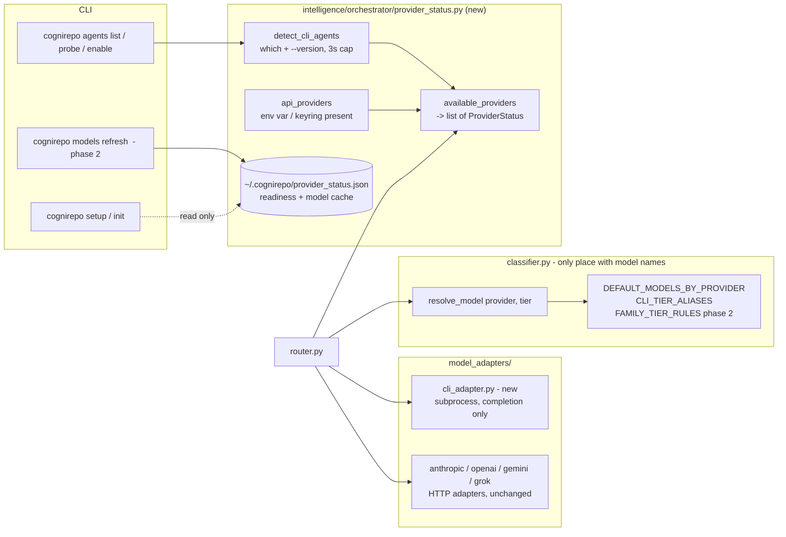

# Design — Provider availability: installed agent CLIs + API keys (#87, parent #86)

**Status:** proposed (v2), awaiting approval before #88 (Implementation) starts.
**Supersedes:** v1, which discovered models only through provider list endpoints and therefore did
nothing for users without API keys.
**Scope:** how CogniRepo's own orchestrator learns which backends it can call, adds a headless-CLI
backend, and keeps model IDs from going stale. No change to tier classification.

## 1. Problem

CogniRepo has two kinds of consumers, and this design only concerns the second:

1. **Agents that call CogniRepo** (Claude Code, Cursor, Gemini CLI) over MCP. They choose their own
   model; CogniRepo never needs to know it.
2. **CogniRepo's own orchestrator** (`intelligence/orchestrator/router.py`), which classifies a query
   into QUICK / STANDARD / COMPLEX / EXPERT and calls an LLM itself.

For (2) today:

- `router._available_providers()` returns a provider only if an API-key env var is set. **No key means
  no STANDARD/COMPLEX/EXPERT routing at all**, even when the user has `claude`, `codex` or `gemini`
  installed and logged in.
- Model IDs are hardcoded in `classifier.py` (`DEFAULT_MODELS_BY_PROVIDER`,
  `ADAPTER_STANDALONE_DEFAULTS`) and go stale when providers retire models.
- `interface/cli/init_project.py::_detect_agents()` already runs `shutil.which` for `claude`,
  `gemini`, `cursor`, but only to decide which config files to write. Routing never sees it.

**Constraints (CLAUDE.md and #86):** model-ID literals only in `classifier.py`
(`tests/test_model_id_invariant.py`); offline-first; `setup`/`init`/`index-repo` never block or make
network calls; hardcoded defaults remain the last-resort fallback; adapters are the only code that
talks to a provider; MCP tools make no network or subprocess calls.

## 2. Recommendation in one paragraph

Replace the env-var check with a single `available_providers()` that merges **two sources**:
**(A) installed agent CLIs** (`claude`, `codex`, `gemini`), detected locally with `shutil.which` and a
bounded `--version` call, usable as a headless completion backend through a new `cli_adapter`; and
**(B) API keys**, optionally refreshed against provider list endpoints (the v1 design, now phase 2).
Detection is always on because it only reads. **Using** a CLI as a backend is opt-in per agent,
because it spends the user's subscription quota and sends repo context to a vendor. With no keys,
an enabled CLI is enough to make routing work.

## 3. Architecture



`ProviderStatus` = `{name, kind: "cli"|"api", installed, enabled, ready: true|false|unknown,
version, source}`. `kind` lets the router and `cognirepo agents list` say where each backend comes
from. New modules: `provider_status.py` and `model_adapters/cli_adapter.py`. The router gains a
`kind == "cli"` dispatch branch; HTTP adapters are untouched.

## 4. Source A — installed agent CLIs

### 4.1 What was checked

Flags below were read from `--help` on this machine (claude 2.1.312, codex-cli 0.155.1, gemini
0.31.0). **No headless call was made**, so behaviour (auth, output shape, isolation actually holding)
is unverified. See section 9.

| | claude | codex | gemini |
|---|---|---|---|
| Headless | `claude -p` (`--print`) | `codex exec` | `gemini -p` |
| Prompt input | stdin or arg | stdin if prompt omitted or `-` | `-p`, appended to stdin |
| Structured output | `--output-format json` | `--json` (JSONL events) and `-o FILE` (last message) | `-o json` |
| Model flag | `--model <alias or id>` | `-m <id>` | `-m <id>` |
| Model aliases | yes (`opus`, `sonnet`, ...) | no | no |
| No persisted session | `--no-session-persistence` | `--ephemeral` | none seen |
| Read-only / no tools | `--tools ""` | `-s read-only` | `--approval-mode plan` |
| Skip user config | `--setting-sources`, `--strict-mcp-config` | `--ignore-user-config`, `--ignore-rules` | `-e` (extensions) |
| Non-repo cwd ok | n/a | `--skip-git-repo-check` | n/a |

### 4.2 Isolation — why `--bare` is not the answer

A headless agent loads its own instructions, hooks and MCP servers. Inside a CogniRepo repo that means
`CLAUDE.md`, the CogniRepo MCP server and the prompt-submit hook, so **CogniRepo would call an agent
that calls CogniRepo**. The adapter must run the CLI as a bare completion engine.

`claude --bare` skips hooks, `CLAUDE.md` discovery and plugins, **but also states that Anthropic auth
is strictly `ANTHROPIC_API_KEY` or `apiKeyHelper` and that "OAuth and keychain are never read".** It
therefore works for API-key users and defeats the subscription use case this design exists for. The
subscription path must isolate by other means, applied together:

1. **Neutral working directory.** Run the child with `cwd` set to a fresh empty temp dir. This stops
   `CLAUDE.md`, `AGENTS.md`, `GEMINI.md` and project-scoped MCP config from being discovered at all,
   and works for all three CLIs without relying on a flag.
2. **No tools.** `claude --tools ""`, `codex -s read-only`, `gemini --approval-mode plan`.
3. **No MCP and no user hooks.** `claude --strict-mcp-config` with no `--mcp-config` (and
   `--disable-slash-commands`); `codex --ignore-user-config --ignore-rules` (auth still reads
   `CODEX_HOME`, per its help); gemini: restrict extensions/MCP, flag set to be confirmed in #88.
4. **No persistence.** `--no-session-persistence` / `--ephemeral`.
5. **Recursion guard (belt and braces).** The adapter sets `COGNIREPO_HEADLESS=1` in the child env.
   The CogniRepo MCP server and hook entry points exit as a no-op when it is set, so even a flag
   that silently stops working cannot produce a loop.
6. **Never** pass `--dangerously-*`, `--yolo`, or any approval-bypass flag.

Whether each recipe actually holds (no `CLAUDE.md` read, no MCP spawn, no hook fire) is a #88
acceptance test, run against the real binaries (section 9).

### 4.3 Detection levels — installed is not logged in

`shutil.which` cannot tell whether the user is authenticated, and a real call costs quota. So
readiness is tri-state:

| State | How it is established | Cost |
|---|---|---|
| `installed` | `shutil.which(name)` plus `<name> --version` with a 3 s cap | local, ms |
| `ready` | one successful headless call (`cognirepo agents probe`, or any earlier real routed call) | 1 tiny call |
| `unknown` | installed, never called | none |

`setup`/`init`/`doctor` only compute `installed` (no network, no quota). Readiness is recorded in
`provider_status.json` with the CLI version and is dropped when the version changes. A routed call
that fails with an auth error marks the agent `ready: false` until the next probe. The router treats
`unknown` as usable-but-last in the CLI group, so the first real call is the probe.

### 4.4 Model selection without new model-ID literals

- **claude** accepts aliases. `classifier.py` gains `CLI_TIER_ALIASES = {"claude": {STANDARD: <haiku
  alias>, COMPLEX: <sonnet alias>, EXPERT: <opus alias>}}`. Aliases resolve to the latest model in
  the family inside the CLI itself, so they cannot go stale in CogniRepo, and they are bare family
  tokens that the invariant regex does not match.
- **codex and gemini** have no aliases. By default the adapter **omits `-m`** and uses the model the
  user configured in that CLI. A model is passed only when the user pins one in
  `model_overrides.pin` (section 7). All tiers then map to that single model for those two.
- QUICK is unchanged: it stays on `local-resolver` and never reaches a CLI.

### 4.5 Adapter contract

`cli_adapter.call(**kwargs) -> ModelResponse`, same signature shape as the HTTP adapters.

- Spawn with an argument list (no shell), `shell=False`, hard timeout (default 120 s, config
  `cli_timeout_s`), `# nosec B603` parity with existing subprocess calls.
- Prompt goes over **stdin**, not argv (no `ps` exposure, no argv length limit).
- Child env is an allowlist: `PATH`, `HOME`, `XDG_*`, `CODEX_HOME`, `LANG`, proxy vars, plus
  `COGNIREPO_HEADLESS=1`. **Provider API-key vars are stripped**, because a leftover
  `ANTHROPIC_API_KEY` would make `claude -p` bill the API key instead of the subscription the user
  chose; "CLI" has to mean "the CLI's own login".
- Parse the structured output mode; if it fails, fall back to stdout text. Token counts come from the
  JSON when present, otherwise are estimated and flagged `estimated=true`.
- **Completion only.** `tool_manifest` is ignored (the CLI runs its own agent loop with tools off).
  Streaming is out of scope for phase 1; the router's stream path yields the full text as one chunk.
- Errors: `ModelCallError(provider, status_code, message)` is HTTP-shaped. Mapping: spawn failure or
  timeout -> `None` (retryable); non-zero exit with an auth message -> 401; rate-limit message ->
  429; other non-zero exit -> 500 (non-retryable once). Message matching is best-effort; an
  unrecognised failure is never retried more than once.

### 4.6 Opt-in and consent

Using a CLI backend sends repo-derived context to the vendor and consumes the user's subscription
quota, so detection is automatic but enabling is explicit:

```
cognirepo agents list                 # installed / enabled / ready / version
cognirepo agents probe [name]         # one tiny call, sets ready
cognirepo agents enable|disable name  # writes cli_providers.<name>.enabled
```

```json
"cli_providers": { "claude": {"enabled": true}, "codex": {"enabled": false} }
```

`setup` prints one line when it detects CLIs and, in the interactive wizard only, asks once per
detected CLI with default **No**. Non-interactive setup never enables anything.

### 4.7 Open policy question (blocking merge)

Whether each vendor's terms permit driving a consumer subscription login headlessly from a
third-party tool has **not** been verified. Anthropic in particular distinguishes API-key use from
subscription OAuth, and `--bare` reserving OAuth to the interactive path is a hint that the vendor
cares. #88 must record the relevant terms for all three vendors before merge. If a vendor
disallows it, that CLI is dropped from the registry and only API-key use remains for it. The opt-in
default (4.6) is what keeps this safe to ship while that is settled.

## 5. Merging the two sources

`available_providers()` returns an ordered list. Rules:

1. A provider with a usable API key and one with an enabled CLI are separate entries (`anthropic`
   and `claude-cli`); the router chooses between them.
2. **Default preference: API key before CLI**, because it is faster (no process start), exposes real
   token usage, and has deterministic errors. CLI is the fallback when the key path fails, and the
   only path when no keys exist. Switchable with `"provider_preference": "cli"`.
3. The existing fallback chain in `_dispatch_with_fallback` is reused; CLI entries are appended as
   normal providers.
4. With no keys and no enabled CLI, behaviour is byte-identical to today.

## 6. Source B — API-key discovery (phase 2, opt-in)

Unchanged in intent from v1, condensed here. It matters only to users with keys, and it can ship after
phase 1 or be dropped if nobody needs it.

| Provider | Endpoint | Auth | Notes |
|---|---|---|---|
| Anthropic | `GET /v1/models?limit=100` | `x-api-key`, `anthropic-version` | paginate `after_id`/`has_more` |
| OpenAI | `GET /v1/models` | `Authorization: Bearer` | mixes chat/embedding/audio: filter |
| Gemini | `GET /v1beta/models?pageSize=100` | `x-goog-api-key` header, never `?key=` | filter on `generateContent` |
| Grok | `GET /v1/language-models`, fall back to `/v1/models` | `Authorization: Bearer` | OpenAI-compatible |

These are as understood at design time; #88b must verify each against a live key.

- **Trigger:** `cognirepo models refresh [--provider P]` only. 5 s per provider, 8 s wall clock,
  thread pool of 4. `setup`/`init`/`index-repo` never fetch.
- **Tiering:** pure `assign_tier(provider, ModelInfo) -> Tier | None`. Drop non-chat models, then an
  ordered `FAMILY_TIER_RULES` table in `classifier.py` (haiku/mini/nano/flash -> STANDARD,
  sonnet/gpt base/pro -> COMPLEX, opus/reasoning/ultra -> EXPERT), newest version wins within a tier,
  a 32k context guard where reported, **unknown family = unassigned and never auto-selected**.
- **Overrides** in `.cognirepo/config.json`, precedence `pin` > explicit `models` block > `tiers` /
  heuristic > hardcoded default:

  ```json
  "model_overrides": {
    "pin":   {"anthropic": {"COMPLEX": "<model-id>"}, "codex": {"ANY": "<model-id>"}},
    "deny":  ["<model-id>"],
    "tiers": {"<model-id>": "EXPERT"}
  }
  ```
- **Cache:** the `api` section of `~/.cognirepo/provider_status.json`, 24 h TTL per provider, keyed by a
  `sha256(key)[:12]` fingerprint (never the key), rules-hash invalidation, ignore-not-delete when
  stale. A runtime 404 / model-specific 400 marks that model denied until the next refresh.
- **Resolution ladder** (`classifier.resolve_model(provider, tier)`, every rung total, caught at one
  boundary): pin / explicit config -> fresh cache with fingerprint match and a newer same-family
  model -> hardcoded default. Timeouts, 401/403, 429, 5xx, empty or malformed bodies, and a corrupt
  cache all fall to the default; **an empty list never overwrites a good cache**.
- **Augment, never replace:** `DEFAULT_MODELS_BY_PROVIDER` and `ADAPTER_STANDALONE_DEFAULTS` stay
  immutable constants. `router._PROVIDER_DEFAULT_MODELS` and adapter defaults keep reading them for
  standalone calls; only router tier dispatch goes through `resolve_model`.

## 7. Storage and config

- **`~/.cognirepo/provider_status.json`** (new, per-user, `0600`, atomic tmp + `os.replace`). One file
  with `cli` and `api` sections. Per-user because both CLI login and API keys are per-user, and one
  login serves many repos. Needs a one-line addition to the storage exceptions in CLAUDE.md (same
  rationale as `repos.json`).
- **`.cognirepo/config.json`** (per-repo, existing): `cli_providers`, `provider_preference`,
  `cli_timeout_s`, `model_overrides`. All optional; no migration.
- Cached IDs are validated against `^[A-Za-z0-9._:/-]{1,128}$` before use. No key or token is ever
  written to the cache or logs.

## 8. Risks and mitigations

| Risk | Mitigation |
|---|---|
| Recursion: agent calls CogniRepo, CogniRepo calls agent | neutral cwd, tools off, MCP/hooks off, `COGNIREPO_HEADLESS` no-op guard, acceptance test |
| Vendor terms disallow headless subscription use | opt-in per CLI, policy check is merge-blocking (4.7), registry entry can be removed |
| Spends subscription quota unexpectedly | explicit enable, default No, `agents list` shows what is enabled, CLI never ahead of an API key by default |
| Repo context sent to a vendor | same exposure as the API path; stated in the enable prompt |
| Installed but not logged in | tri-state readiness; auth failure marks `ready: false` and falls through the chain |
| CLI flag changes between versions | capability table pinned per CLI version; unknown version -> treat as `installed`, `ready: unknown`, adapter refuses if a required isolation flag is rejected |
| Latency (process start, seconds) | CLI is fallback by default; not used for QUICK; 120 s cap |
| Fragile stderr/exit-code error mapping | best-effort, bounded retry, never loops |
| Heuristic mis-tiers a new API model (phase 2) | unknown stays unassigned; `pin` / `tiers` overrides; `models list` shows why |
| Cache tampering / key leakage | `0600`, ID validation, header auth, hash-prefix fingerprint only |

## 9. Verified vs not verified

**Verified (read from `--help` on this machine):** the three binaries exist; the headless entry points,
model flags, output-format flags and isolation flags listed in 4.1; `--bare` excluding OAuth/keychain;
`_available_providers()` is env-var only; `_detect_agents()` exists and is unused by routing;
`ModelCallError` is HTTP-shaped.

**Not verified (each is a #88 acceptance item):**
- Any actual headless call: login reuse, output JSON shape, token fields, exit codes on auth failure.
- That the isolation recipe really prevents `CLAUDE.md`/MCP/hook loading for each CLI, in particular
  `claude --setting-sources` accepting an empty set and gemini having any way to disable MCP.
- That the neutral-cwd approach does not break auth lookup for any CLI.
- Vendor terms for headless subscription use (4.7).
- The v1 provider list endpoints and fields (section 6) against live keys.

## 10. Phasing, rollout and docs

- **Phase 1 (#88a): CLI source.** `provider_status.py`, `cli_adapter.py`, router dispatch branch,
  `agents list/probe/enable/disable`, setup line + wizard prompt, `doctor` line, recursion guard.
  Delivers the value for no-key users.
- **Phase 2 (#88b): API discovery.** `models refresh/list/clear`, `FAMILY_TIER_RULES`, `resolve_model`
  ladder, cache. Can be deferred or cut; decision 5 below.
- Additive: no CLI enabled and no keys behaves exactly as today.
- Docs to update in #88: `docs/CLI.md`, `docs/CLI_REFERENCE.md`, `docs/CONFIGURATION.md`,
  `docs/ARCHITECTURE.md`, `docs/USAGE.md`, and the CLAUDE.md storage-exception line for
  `~/.cognirepo/provider_status.json`.

## 11. Work breakdown and test mapping (#89)

| # | Item | #89 case |
|---|---|---|
| 1 | `detect_cli_agents`, `ProviderStatus`, tri-state readiness | detect present/absent/hung binary; version change drops `ready` |
| 2 | `cli_adapter` (spawn, stdin, env allowlist, parse, error map) | success; timeout; auth failure; garbage output; env has no API keys |
| 3 | Isolation recipe + `COGNIREPO_HEADLESS` guard | child does not read `CLAUDE.md`, spawn MCP, or fire hooks (real-binary test, skipped if absent) |
| 4 | `CLI_TIER_ALIASES` + invariant | `test_model_id_invariant` stays green; codex/gemini omit `-m` unless pinned |
| 5 | Router merge + preference + fallback chain | no keys + enabled CLI routes; key-first default; both fail -> `ModelCallError` |
| 6 | `agents` CLI, setup/wizard/doctor | default-No prompt; non-interactive never enables |
| 7 | Phase 2 items (fetch, tier, cache, ladder) | v1 test mapping, unchanged |
| 8 | Docs + CLAUDE.md storage exception | n/a |

Latency criterion: `setup`/`init` add one bounded `--version` per detected CLI (3 s cap, run in
parallel) and a local JSON read; nothing on the no-CLI path. #89 includes a regression check.

## 12. Decisions requested from the reviewer

1. Approve **two sources** (CLI + API key) behind one `available_providers()`.
2. Approve **detect automatically, enable explicitly** (default No, per CLI) for CLI backends.
3. Approve **API key before CLI** as the default preference (switchable).
4. Approve the **subscription isolation recipe** (neutral cwd + tools off + MCP/hooks off +
   `COGNIREPO_HEADLESS` guard) instead of `claude --bare`, and **stripping API-key env vars** from the
   child.
5. Decide whether **phase 2 (API discovery)** ships, is deferred, or is cut.
6. Make the **vendor-terms check** (4.7) a merge blocker for #88a.
7. Approve a per-user `~/.cognirepo/provider_status.json` and the matching CLAUDE.md storage
   exception.
